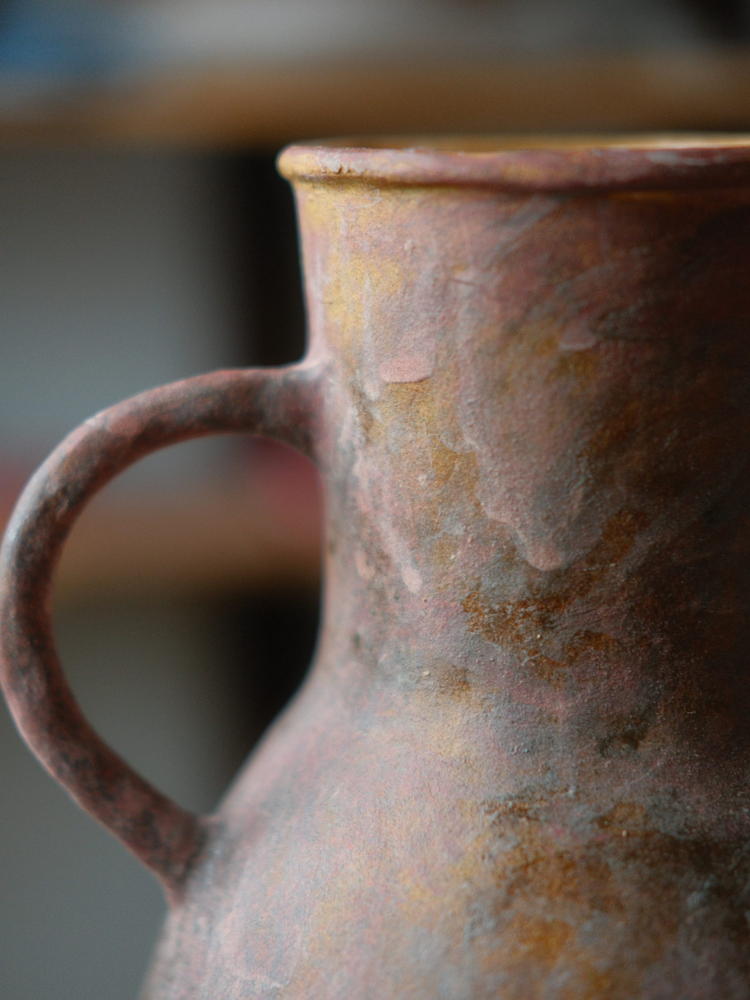
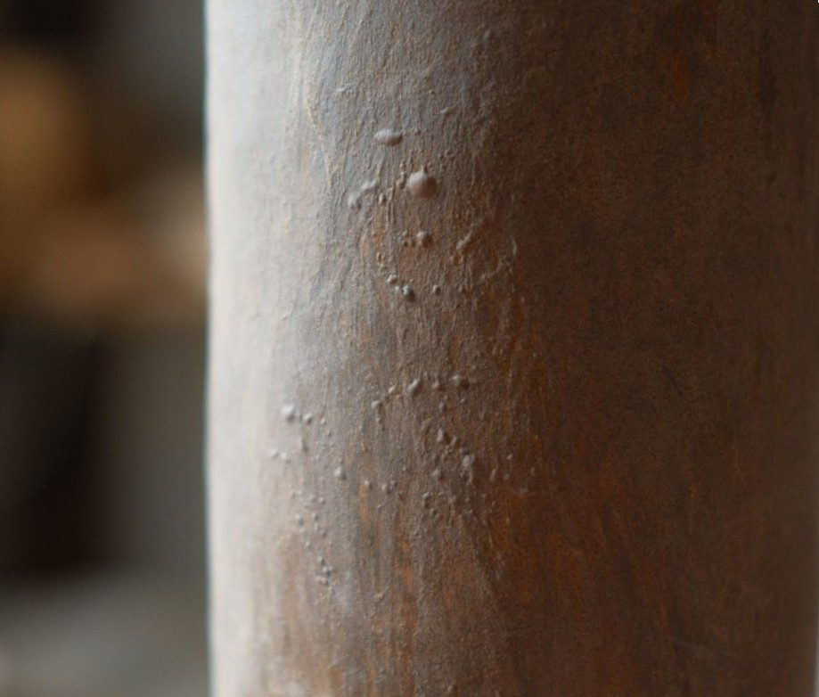
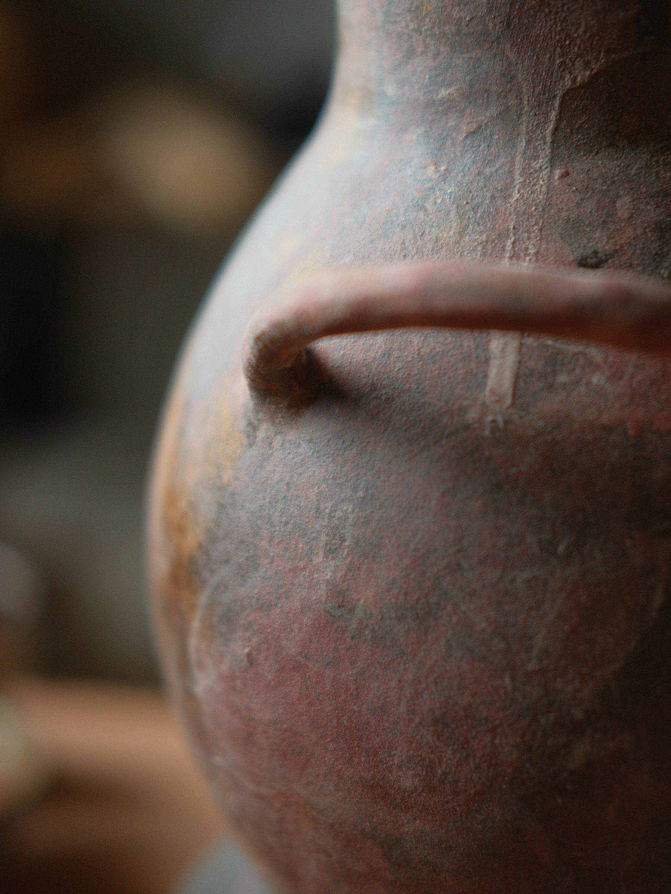
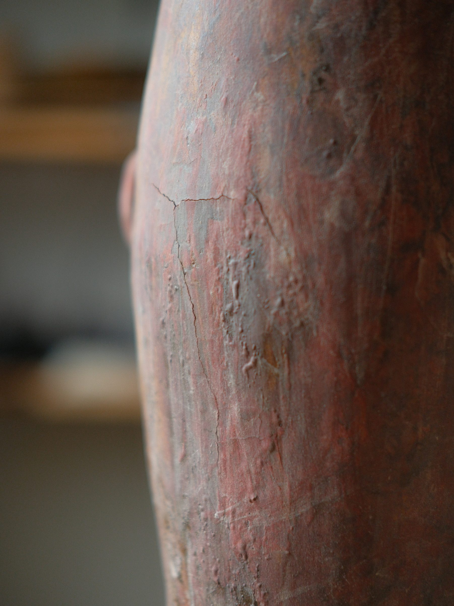

有時候瑕疵是刻意保留的藝術表現，但是更多時候是不請自來的人中大爛痘阿！

## § 01 · 上化妝土

Cape 01 選擇的化妝土，色調與質感的平衡在執行上關卡重重。

首先是土坯的第一層化妝土。需要在土坯達到恰到好處的皮革硬時，才能好好地敷上；並且不能一次上得太厚，避免讓土坯因為吸收太多水分而濕軟變形。

上好之後，要仔細觀察厚度與筆觸、海綿印是否平衡恰當。不足的地方需要補，但要避免洗掉已經敷上的那一層。

化妝土層也不能放到全乾，因為接著需要進行簡單的拋光整理；不然燒結後可能會太過粗糙——我不想傷害任何無辜的毛衣與絲質襯衫。

## § 02 · 整理素坯

成功燒出素燒坯之後，就要來處理上釉的部分了。

外側要保留土的紋理與色調，因此順利上好第一層的品項，這邊稍微輕鬆一些——只需要檢查外側是否有需要用薄釉順平的粗糙點，以及在內側上一層方便保養與使用的釉面就好。但第一階段沒整理好的品項，在這邊就得努力挽救了（雖然到了這個步驟再救，存活率已經很低了）。

如果第一層的化妝土上得太薄，在這個階段可以配合釉藥、薄薄再補上一次。但這個釉藥與化妝土的比例，我至今抓到甜蜜點的機率，可能不過 50% 吧。

釉太少，有機會整片龜裂剝落；釉太多，則可能原地起泡，而且一壓就碎——無法容忍的錯誤。

## § 03 · 開窯的悲傷五階段

開窯時的成功率，大概可以決定這一窯的「悲五」需要輪迴幾次。對，每次開窯都需要悲五一下：

1. 為什麼土坯的時候不好好整理？
2. 為什麼素燒完還不整理？
3. 為什麼上完第一層釉不多等幾小時？
4. 為什麼上第二層之前沒有好好檢查邊緣？
5. 為什麼不重新配釉跟化妝土？（釉藥用久之後難免走調，就像阿媽的那鍋滷汁。）

反(ㄅㄠˋ)省(ㄩㄢˋ)完畢。總之，謹慎小心、好好選擇，做個有耐心的好土人！

Sometimes a flaw is a deliberate aesthetic choice. More often, though, it's an uninvited pimple right in the middle of your face.

### § 01 · Laying the slip

The slip I chose for Cape 01 makes the balance of colour and texture a hard thing to pull off in practice.

It starts with the first coat of slip. The body has to reach just the right leather-hard stage before I can lay it on properly — and never too thick in one go, or the piece drinks in so much water that it slumps and deforms.

Once it's on, I check that the thickness, the brushstrokes and the sponge marks are all even. Thin spots need a touch-up, but without washing off the layer already laid down.

The slip can't be left to dry completely either, because a light polish comes next — otherwise the fired surface turns too rough, and I'd rather not harm any innocent sweaters or silk shirts.

### § 02 · Tending the bisque

Once a piece survives the bisque firing, it's time to deal with the glaze.

The outside keeps the bare clay's texture and colour, so the pieces whose first coat went on well are easier here — I just check the outside for rough spots that need smoothing with a thin wash, and give the inside a practical glaze for care and daily use. But the pieces I didn't tidy up in the first stage have to be rescued now (though by this step the survival rate is already very low).

If the first slip coat went on too thin, I can add a thin pass of glaze over it at this stage. But the ratio of glaze to slip — my odds of hitting the sweet spot are, to this day, probably no better than 50%.

Too little glaze, and the whole sheet can craze and flake off; too much, and it blisters in place, crumbling at a touch — an intolerable mistake.

### § 03 · The five stages of kiln-opening grief

How well a kiln turns out pretty much decides how many rounds of grief I'll have to cycle through. Yes — every kiln opening calls for a little grieving:

1. Why didn't I tidy the body properly at the greenware stage?
2. Why didn't I tidy it after the bisque firing?
3. Why didn't I wait a few more hours after the first glaze coat?
4. Why didn't I check the edges before the second coat?
5. Why didn't I mix the glaze and slip fresh? (Both drift out of tune with age — like grandma's forever pot of braising sauce.)

Self-reflection (read: complaining) complete. In the end: be careful, choose well, and be a patient, good clay person!

